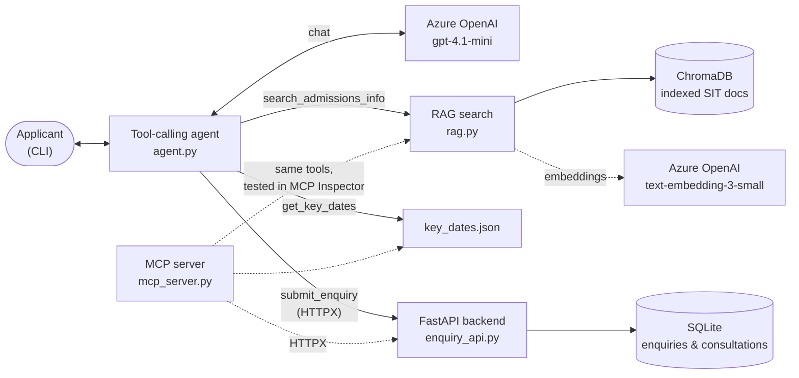

# SIT Admissions Assistant

An AI assistant that answers prospective applicants' questions about applying to the Singapore Institute of Technology (SIT) using official public sources, and turns unanswered or case-specific questions into structured enquiries for the admissions team.

## What It Does

* **Cited Q&A from Official Pages:** Searches public SIT documents (entry requirements, application steps, programme overviews, fees, and financial aid) and answers strictly from what it finds, complete with source links and dates.
* **Key Dates Lookup:** Pulls verified application windows and deadlines from a local `key_dates.json` file.
* **MCP Tool Server:** Exposes four tools (`search_admissions_info`, `get_key_dates`, `submit_enquiry`, and `book_consultation`) built with the official Python MCP SDK (`FastMCP`).
* **Smart Agent with Human Confirmation:** Picks the right tool for each question. If the retrieved info isn't strong enough—or if the user is asking about their personal eligibility—it refuses to guess, drafts an enquiry, and asks for confirmation before submitting.
* **Mock Enquiry & Consultation API:** Saves confirmed enquiries and consultation bookings into a local SQLite database through a FastAPI backend.

## How It Works

